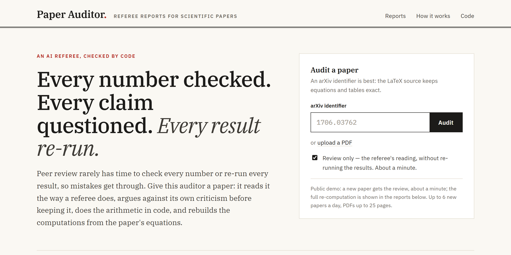
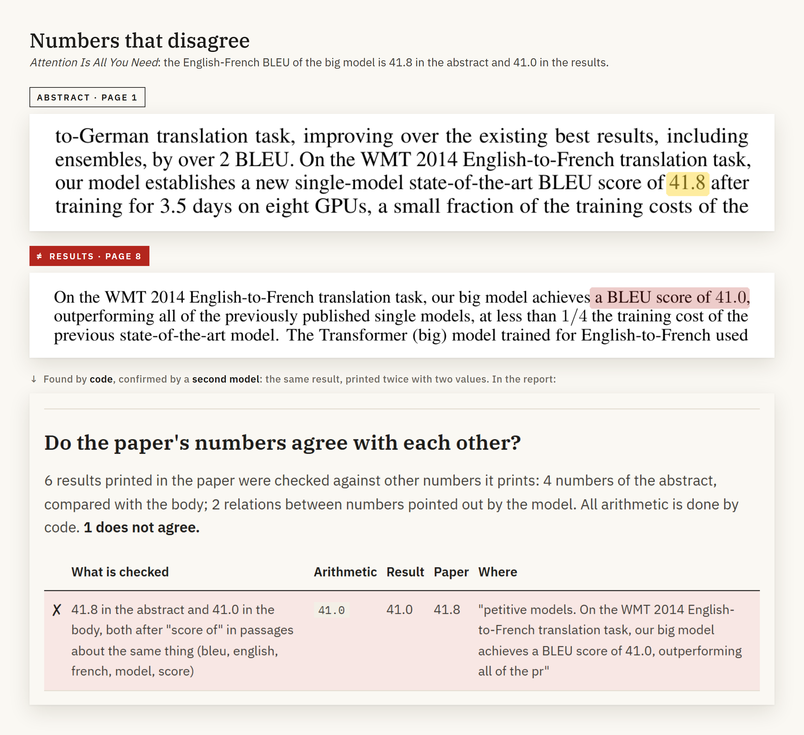
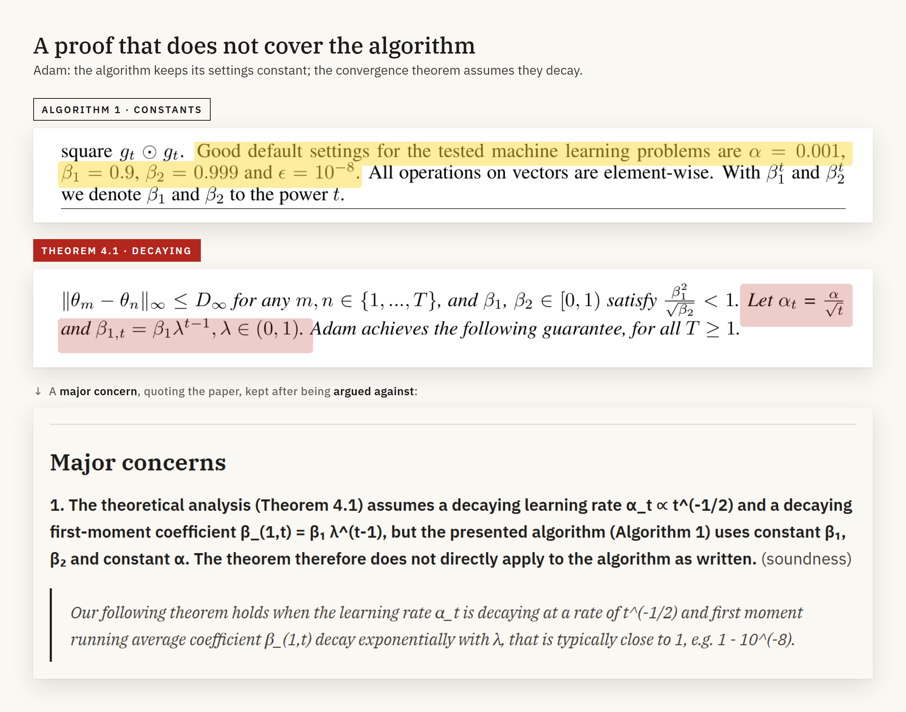
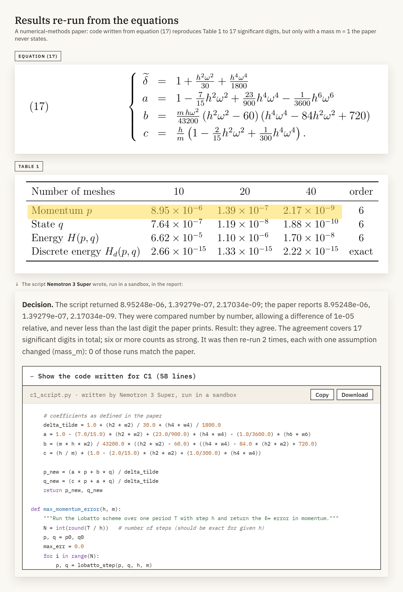
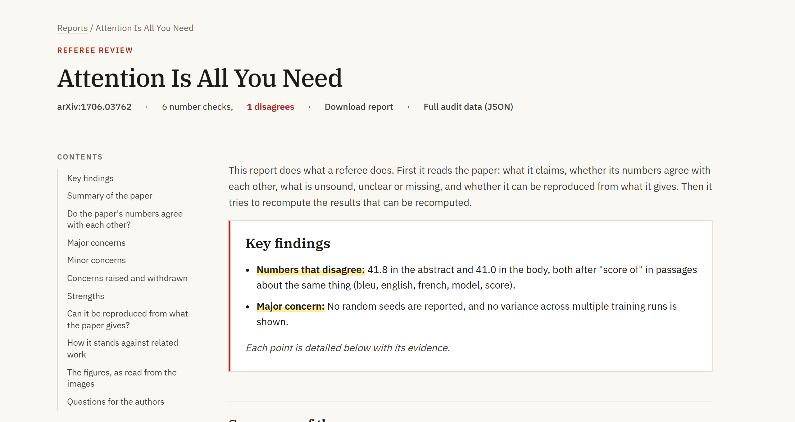
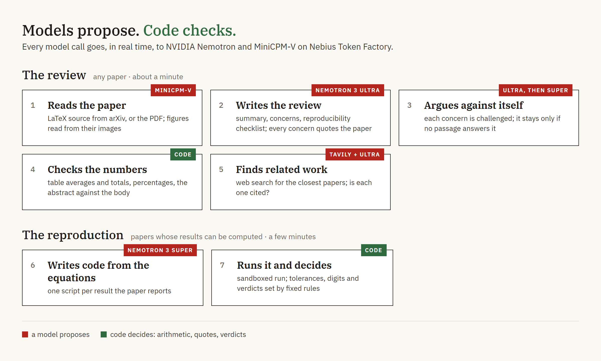
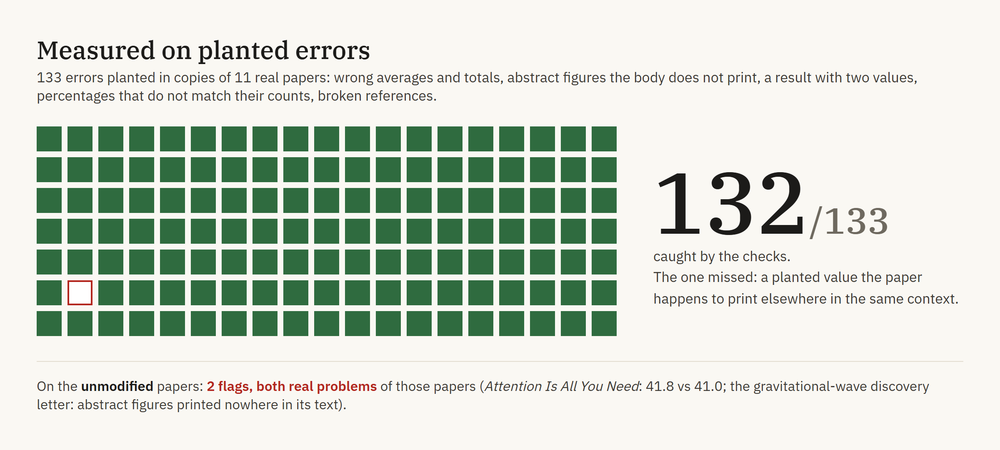

# Paper Reproducibility Auditor

**An AI referee for scientific papers.** Give it an arXiv id or a PDF: it reads the
paper the way a reviewer does, checks its numbers against each other, questions
every claim, and re-runs the results it can compute.

[](https://paper-auditor.onrender.com)
[](https://www.youtube.com/watch?v=_dV-2sauzTs)
[](https://tokenfactory.nebius.com)
[](https://tokenfactory.nebius.com)
[](LICENSE)

[](https://paper-auditor.onrender.com)

▶ **[Watch the 3-minute demo](https://www.youtube.com/watch?v=_dV-2sauzTs)**: the PDF of each paper next to
what the auditor found in it, a real run, and the code it writes.

Built for the Nebius × NVIDIA Global AI Hackathon. The demo is a free instance:
the first visit after a quiet spell takes about a minute to wake it up. The
example reports open at once; a new paper gets the review in about a minute.

## What it finds

Peer review rarely has time to check every number or re-run every result. These
are three things the auditor found in well-known papers.







Every report opens with its key findings, and every finding links to its
evidence: the passage quoted, the arithmetic, the code.



## How it works



Every model call goes, in real time, to [Nebius Token Factory](https://tokenfactory.nebius.com)
through its OpenAI-compatible API:

| Model | What it does |
| --- | --- |
| **NVIDIA Nemotron 3 Ultra** | writes the review, argues against each concern, plans the claims to re-compute, writes the report's narrative |
| **NVIDIA Nemotron 3 Super** | writes the code that re-runs each result, repairs it, confirms or rejects mismatches as a second reader |
| **NVIDIA Nemotron 3 Nano** | quick tasks: web queries for missing details, classifying why a script failed |
| **MiniCPM-V** | reads the figures, and transcribes PDFs that have no LaTeX source |

Tavily searches the web for related work and for details a paper defers to
another one.

The rule that runs through it: **a model may propose, but nothing reaches the
report on a model's word alone.**

- **Every concern quotes the paper**, and the quote is looked up in the text.
  No quote, no concern.
- **Every concern is argued against** by a second reading. The report shows the
  withdrawn ones too, with the passage that answered them.
- **All arithmetic is done by code.** A mismatch the code finds by wording is
  reported only if a second model confirms both numbers are the same quantity.
- **Verdicts follow fixed rules**: tolerances, agreeing digits, confidence. A
  model writes the code; it does not grade it.
- **Same paper, same report.** Every model call is recorded under the hash of
  its input, so an audit can be replayed byte for byte.

Each step, the safeguards and the limits are described in
[docs/technical.md](docs/technical.md).

## Measured



`python tools/evaluate.py` plants errors in copies of real papers and counts how
many the checks catch. Details and limits in [evaluation.md](evaluation.md).

## Run it

Requires Python 3.12, a [Nebius Token Factory](https://tokenfactory.nebius.com)
key and a [Tavily](https://tavily.com) key.

```
python -m venv .venv
.venv\Scripts\activate          # Windows; on Linux/macOS: source .venv/bin/activate
pip install -r requirements.txt
cp .env.example .env            # then add NEBIUS_API_KEY and TAVILY_API_KEY
```

In the browser:

```
python app.py                   # then open http://127.0.0.1:7860
```

From the command line:

```
python -m auditor 1706.03762 --review-only   # the review: about a minute, $0.10–0.25
python -m auditor 2504.00560                 # review and re-computation: 3–8 minutes
python -m auditor papers/paper.pdf           # a PDF
```

The report, the audit data, every generated script and every model reply go to
`runs/<paper>/`. To publish the demo for free, see
[the public demo](docs/technical.md#the-public-demo-and-its-budget).

## License

MIT. See [LICENSE](LICENSE).
